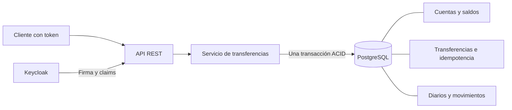

# Quark Bank

Proyecto de aprendizaje bancario con **transferencias internas y un sublibro contable de partida doble**, Java 21, Quarkus 3.40.1.2 LTS, PostgreSQL 17.12 y Keycloak 26.8.2. Ejecución local con Docker Compose. Las monedas iniciales son PEN y USD; cada transferencia requiere cuentas de la misma moneda.

Quarkus encaja en APIs de banca digital, servicios de pagos e integración con sistemas bancarios existentes. [Red Hat incluye Quarkus en su plataforma para modernizar servicios de pagos](https://www.redhat.com/en/resources/bring-ai-into-banking-overview). Este proyecto aplica esas capacidades a una transferencia interna; no pretende medir qué caso de uso tiene mayor cuota de adopción.

## Ejecutar en Windows

Requisitos: Java 21 y Docker Desktop iniciado. Maven Wrapper descarga Maven y las dependencias durante la primera ejecución.

```powershell
docker compose up -d --wait postgres keycloak
.\mvnw.cmd quarkus:dev
```

Keycloak puede tardar unos segundos adicionales en importar el realm. Comprueba que abre [la configuración OIDC](http://127.0.0.1:8180/realms/quark-bank/.well-known/openid-configuration) antes de iniciar Quarkus.

- API: <http://127.0.0.1:8080/api/accounts>
- Swagger UI: <http://127.0.0.1:8080/q/swagger-ui/>
- Salud: <http://127.0.0.1:8080/q/health>
- Métricas de desarrollo: <http://127.0.0.1:8080/q/metrics>
- Keycloak: <http://127.0.0.1:8180/admin/>, usuario `admin`, contraseña `admin-local-only`.
- PostgreSQL: `127.0.0.1:15432`, base `bank`, usuario `bank`, contraseña `bank-local-only`.

En Linux/macOS usa `./mvnw` en lugar de `.\mvnw.cmd`.

## Probar una transferencia

Con Quarkus ejecutándose, abre otra terminal:

```powershell
.\scripts\demo.ps1
```

El script obtiene un token de Alice, transfiere PEN 25.50 a Bob y repite exactamente la solicitud. El segundo intento devuelve el mismo identificador y no vuelve a mover dinero. Cada ejecución del script crea una transferencia nueva.

| Usuario local | Contraseña | Rol | Cuenta de demostración | Saldo inicial |
| --- | --- | --- | --- | --- |
| alice | alice-local-only | customer | 10000000-0000-0000-0000-000000000001 | PEN 1000.00 |
| bob | bob-local-only | customer | 10000000-0000-0000-0000-000000000002 | PEN 250.00 |
| operator | operator-local-only | operator | Puede abrir cuentas en cero y consultar cuentas | — |

Los identificadores de propietario coinciden con el claim `sub` del token. Los datos iniciales y su contrapartida de patrimonio se cargan exclusivamente en desarrollo; los saldos iniciales también tienen asientos contables. El volumen de PostgreSQL conserva los saldos entre reinicios. `docker compose down` detiene el entorno y conserva ese volumen.

Ejemplo de solicitud, con `Authorization: Bearer <access_token>`:

```http
POST /api/transfers
Content-Type: application/json
Idempotency-Key: transferencia-001

{
  "sourceAccountId": "10000000-0000-0000-0000-000000000001",
  "destinationAccountId": "10000000-0000-0000-0000-000000000002",
  "amount": 25.50,
  "currency": "PEN"
}
```

## Contrato de la API

| Método y ruta | Acceso | Resultado |
| --- | --- | --- |
| `GET /api/accounts` | Cliente u operador | Hasta 100 cuentas; un cliente solo ve las propias |
| `POST /api/accounts` | Operador | Abre una cuenta con saldo cero; cuerpo `{"ownerId":"alice","currency":"PEN"}` |
| `GET /api/accounts/{id}` | Propietario u operador | Cuenta y saldo |
| `GET /api/accounts/{id}/entries?limit=50&offset=0` | Propietario u operador | Movimientos, límite máximo 100 |
| `POST /api/transfers` | Cliente propietario del origen | Transferencia atómica, exige `Idempotency-Key` |
| `GET /api/transfers/{id}` | Cliente que ordenó la transferencia u operador | Transferencia registrada |

Transferencia nueva: `201`. Reintento confirmado: `200` y `Idempotency-Replayed: true`. Misma clave y otros datos: `409`. Saldo insuficiente, cuentas iguales o distinta moneda: `422`. Datos inválidos: `400`. Sin autenticación: `401`. Rol insuficiente: `403`. Recursos ajenos al cliente: `404`.

La clave de idempotencia pertenece al usuario autenticado. Se conserva con la transferencia, sin caducidad automática. Una operación rechazada no consume la clave. Ante un timeout o una respuesta incierta, repite la misma solicitud y la misma clave.

## Diseño y decisiones



La aplicación tiene capas `api`, `application`, `domain` e `infrastructure`. JDBC permite ver explícitamente el SQL, el orden de bloqueos y las restricciones de PostgreSQL. Narayana coordina la transacción local. Mantener el movimiento de dinero en una sola base permite confirmar el débito, el crédito y el asiento juntos.

1. **Dinero exacto:** `BigDecimal` y `NUMERIC(19,2)`; hasta 17 enteros y 2 decimales. Se rechazan fracciones de centavo y desbordamientos, sin redondear una transferencia.
2. **Concurrencia:** `SELECT ... FOR UPDATE`, bloqueos de cuentas ordenados por UUID y aislamiento `READ COMMITTED`. El saldo se valida después de adquirir los bloqueos.
3. **Idempotencia:** consulta antes y después de los bloqueos, más una restricción única por usuario y clave. `INSERT ... ON CONFLICT` resuelve carreras por la misma clave.
4. **Contabilidad:** cada diario tiene dos movimientos cuya suma es cero. Positivo aumenta el saldo del sublibro; negativo lo reduce. Los triggers diferidos comprueban al confirmar que las monedas coinciden, la transferencia corresponde al diario y los saldos coinciden con sus movimientos.
5. **Historial:** los movimientos, diarios y transferencias rechazan `UPDATE` y `DELETE`. Una reversa debe generar una operación compensatoria; ese endpoint queda para una siguiente iteración.
6. **Identidad:** OIDC valida firma, issuer y audiencia; el propietario se obtiene de `sub`. Las comprobaciones de rol y propiedad se aplican en el servidor.
7. **Operación:** Flyway versiona el esquema; Health, OpenAPI y Prometheus permiten inspeccionarlo. Las métricas están bloqueadas por defecto fuera de desarrollo y pruebas.

Los triggers son una protección de integridad para este ejemplo. La reconciliación por suma de movimientos en cada operación tiene un coste que crece con el historial; antes de una carga alta se debe medir y diseñar una estrategia de proyecciones y reconciliación apropiada.

## Verificación

```powershell
docker compose up -d --wait postgres
.\mvnw.cmd verify
```

Las pruebas usan PostgreSQL real, en la base separada `bank_test`, creada al inicializar el volumen. Antes de cada prueba vacían exclusivamente las cuatro tablas de esa base y cargan una fixture. No apuntes la configuración de pruebas a una base con información que quieras conservar.

Se comprueban transferencias y balances, permisos, validación, idempotencia, sobregiros simultáneos, reintentos simultáneos, transferencias en sentidos opuestos, inmutabilidad y rechazo de diarios desbalanceados. Las pruebas HTTP usan identidades de prueba; `scripts/demo.ps1` comprueba el flujo con un token real de Keycloak.

## Siguiente evolución

Esta versión cubre el flujo local de aprendizaje. La configuración de Keycloak usa contraseñas y password grant de demostración. Para una aplicación con usuarios reales, el siguiente paso es Authorization Code con PKCE, MFA y TLS, junto con gestión de secretos y separación de credenciales de migración y aplicación. El usuario de PostgreSQL de Compose es administrativo para facilitar el laboratorio; en despliegue debe usar privilegios mínimos.

Antes de ampliar el alcance hay que decidir país y normativa aplicable, límites por operación y por día, aprobaciones, reversas, SLO y recuperación ante fallos. No se han implementado KYC/AML, pagos externos, tipo de cambio ni certificaciones regulatorias.

Para notificaciones o Kafka, añadiríamos transactional outbox y consumidores idempotentes. Primero registraríamos el evento en la misma transacción; un publicador separado lo entregaría después. Las integraciones externas necesitan timeouts, reintentos y circuit breakers adecuados al contrato del proveedor.

Para construir el contenedor JVM:

```powershell
.\mvnw.cmd package -DskipTests
docker build -f src/main/docker/Dockerfile.jvm -t quark-bank:local .
```

El perfil normal requiere `DB_URL`, `DB_USERNAME`, `DB_PASSWORD` y `OIDC_AUTH_SERVER_URL`. No carga cuentas de demostración. La compilación nativa, Kubernetes, pruebas de carga, copias de seguridad y un pipeline de seguridad quedan como siguientes pasos del proyecto.

Referencias: [versiones LTS](https://quarkus.io/releases/), [transacciones en Quarkus](https://quarkus.io/guides/transaction), [autenticación OIDC](https://quarkus.io/guides/security-oidc-bearer-token-authentication/), [Flyway](https://quarkus.io/guides/flyway/).
